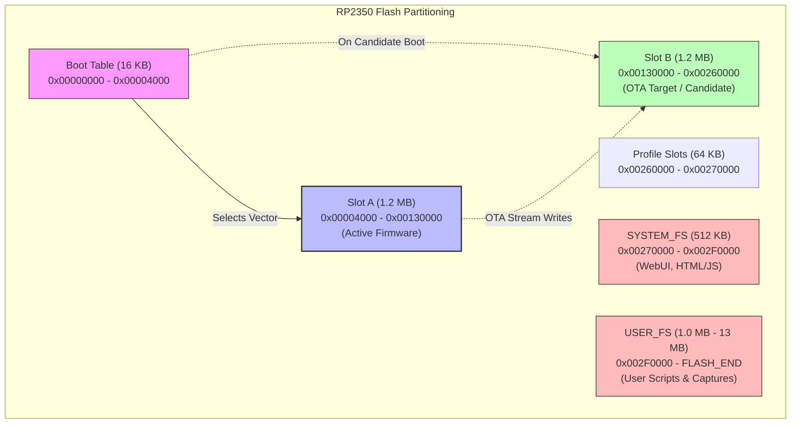
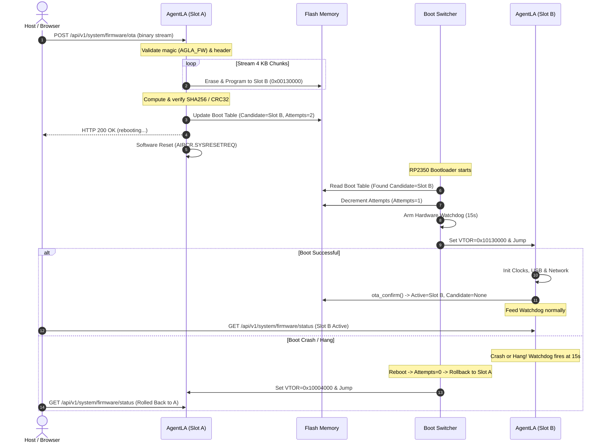

## Context

The AgentLA probe runs on the RP2350 microcontroller (4 MB flash on Raspberry Pi Pico 2, 16 MB flash on BakuProbe). The probe's on-chip SPI flash is currently partitioned into single-slot firmware (`0x00000000` to `0x00180000`), profile storage (`0x00180000` to `0x00190000`), `SYSTEM_FS` LittleFS (`0x00190000` to `0x00210000`), and `USER_FS` LittleFS (`0x00210000` to end of flash).

Updating the probe currently requires manually pressing the BOOTSEL button or calling `picotool reboot -f -u` to enter USB mass-storage bootloader mode. This presents two critical problems:
1. **Remote/Headless Inaccessibility**: Entering BOOTSEL terminates the CDC-NCM Ethernet session, requiring physical hands-on intervention or custom host scripting to reflash.
2. **Catastrophic LittleFS Corruption**: If a user accidentally drops a stock Raspberry Pi UF2 image (e.g. MicroPython or CircuitPython) or an oversized monolithic firmware build into the BOOTSEL drive, the binary silently overwrites sectors above `0x00180000`, wiping profile slots, system web applications, and user test scripts.

To resolve this, we implement **True A/B Dual-Slot Firmware OTA** (Architecture C). Firmware updates are streamed live over the Ethernet interface directly into an inactive flash slot while active services continue uninterrupted. Once uploaded and verified, the probe marks the new slot as a candidate and performs an atomic reboot backed by the RP2350 hardware watchdog. If the new image boots and successfully brings up network services within 15 seconds, it issues `ota_confirm()`. If it crashes, hangs, or panics, the watchdog resets the MCU and the boot manager automatically falls back to the previous known-good slot.

## Goals / Non-Goals

**Goals:**
- **Zero-Risk Partitioning**: Structurally segregate executable firmware (Slots A & B, 1.2 MB each) from LittleFS partitions (`SYSTEM_FS` at `0x00270000`, `USER_FS` at `0x002F0000`). Firmware updates can never cross into LittleFS.
- **In-Service Streaming OTA**: Implement `POST /api/v1/system/firmware/ota` streaming chunks directly from the network into the inactive slot flash sectors with zero intermediate RAM buffering.
- **Image Header & Checksum Validation**: Verify binary magic (`AGLA_FW`), target board signature (`PICO2` or `BAKUPROBE`), payload size (<= 1,228,800 bytes), and SHA-256 / CRC-32 integrity before authorizing reboot.
- **Minimal 16 KB Boot Switcher**: Embed a tiny, invariant boot switcher at `0x00000000` - `0x00004000` that inspects metadata, sets Cortex-M33 VTOR to Slot A (`0x10004000`) or Slot B (`0x10130000`), and vectors execution.
- **Automated Watchdog Rollback**: Enforce candidate boot with a 15-second RP2350 hardware watchdog. Automatic fallback to the last active slot if `ota_confirm()` is not called.
- **Diagnostics & Status Endpoints**: Provide `GET /api/v1/system/firmware/status` and `POST /api/v1/system/firmware/rollback` for observability and operational control.

**Non-Goals:**
- Automatic background polling of cloud servers for updates; OTA updates are initiated via push (Web UI, REST client, or CLI).
- Eliminating the hardware BOOTSEL ROM; BOOTSEL remains as a permanent hardware unbrick safety net of last resort.

## Decisions

### Decision 1: Flash Layout & Partition Boundaries
To guarantee that firmware writes cannot touch configuration or filesystems, flash memory is apportioned symmetrically:

```
+-------------------------------------------------------------------------+
|                  RP2350 FLASH GEOMETRY (4 MB / 16 MB)                   |
+-------------------+----------------+------------------------------------+
| Address Range     | Size           | Content / Partition                |
+-------------------+----------------+------------------------------------+
| 0x00000000 - 0x00004000 | 16 KB    | Boot Switcher & Boot Table (Metadata)|
| 0x00004000 - 0x00130000 | 1,200 KB | Firmware Slot A                    |
| 0x00130000 - 0x00260000 | 1,200 KB | Firmware Slot B                    |
| 0x00260000 - 0x00270000 | 64 KB    | Profile Slots (32 x 2 KB)          |
| 0x00270000 - 0x002F0000 | 512 KB   | SYSTEM_FS (LittleFS: WebUI/Applets)|
| 0x002F0000 - FLASH_END  | ~1.0 MB  | USER_FS (LittleFS: Pico 2)         |
|                   | ~13.0 MB       | USER_FS (LittleFS: BakuProbe)      |
+-------------------+----------------+------------------------------------+
```

* **Rationale**: Sizing slots at 1,200 KB (1.2 MB) accommodates our current ~415 KB release binary with ~785 KB (189%) headroom for future protocol engines, while preserving generous LittleFS user storage.

### Decision 2: Boot Table Metadata & Candidate State Machine
Boot configuration is maintained in a 4 KB sector within the 16 KB Boot Table window (`0x00002000` - `0x00003000`), with an alternate backup sector (`0x00003000` - `0x00004000`) for atomic write cycles.

```rust
#[repr(C)]
pub struct BootTable {
    pub magic: u32,             // 0x41474C41 ("AGLA")
    pub version: u32,           // Boot table structure version (1)
    pub sequence: u32,          // Monotonically increasing sequence number
    pub active_slot: u8,        // 0 = Slot A, 1 = Slot B
    pub candidate_slot: u8,     // 0 = None, 1 = Slot A, 2 = Slot B
    pub boot_attempts: u8,      // Remaining attempts (e.g. 2 -> 1 -> 0)
    pub state: u8,              // 0 = Normal, 1 = TestingCandidate, 2 = RolledBack
    pub slot_a_crc: u32,        // CRC-32 of Slot A payload
    pub slot_b_crc: u32,        // CRC-32 of Slot B payload
    pub slot_a_size: u32,       // Payload length Slot A
    pub slot_b_size: u32,       // Payload length Slot B
    pub crc32: u32,             // Checksum over the BootTable struct
}
```

* **State Transitions**:
  1. **Idle**: `active_slot = A`, `candidate_slot = 0`, `state = Normal`.
  2. **OTA Staging**: Image written to Slot B, verified against payload CRC. Boot table updated to `candidate_slot = B`, `boot_attempts = 2`, `state = TestingCandidate`.
  3. **Candidate Boot**: Probe resets. Boot switcher sees `candidate_slot = B`, decrements `boot_attempts` to 1, arms hardware watchdog (15s), and branches to Slot B.
  4. **Confirmation**: Slot B initializes networking and calls `ota_confirm()`. Boot table updated: `active_slot = B`, `candidate_slot = 0`, `state = Normal`. Watchdog returned to standard system refresh cycle.
  5. **Rollback**: If Slot B faults or watchdog expires before `ota_confirm()`, MCU resets. Boot switcher sees `boot_attempts == 0` for candidate B, marks `state = RolledBack`, clears `candidate_slot = 0`, and branches to `active_slot = A`.

### Decision 3: Minimal Boot Switcher Vector Relocation
The 1st-stage Boot Switcher resides at flash offset `0x00000000` (XIP address `0x10000000`). It is compiled as a tiny `#![no_std]` binary with no peripheral drivers other than basic flash read and watchdog:
```rust
#[no_mangle]
pub unsafe extern "C" fn main() -> ! {
    let target_slot = read_target_slot();
    let slot_addr = match target_slot {
        Slot::A => 0x1000_4000,
        Slot::B => 0x1013_0000,
    };
    
    // Set Vector Table Offset Register to the selected slot
    cortex_m::peripheral::SCB::set_vtor(slot_addr);
    
    // Read Initial SP and Reset Handler PC from slot's vector table
    let sp = *(slot_addr as *const u32);
    let pc = *((slot_addr + 4) as *const u32);
    
    // Branch to application
    asm!(
        "msr msp, {}",
        "bx {}",
        in(reg) sp,
        in(reg) pc,
        options(noreturn)
    );
}
```

* **Position Independence**: Slot binaries are linked with their vector table matching their physical slot base (`0x10004000` for Slot A, `0x10130000` for Slot B) or built position-independent using RP2350 relative addressing. Providing slot-specific builds or wrapping with an image header containing target offset ensures zero vector misalignment.

### Decision 4: In-Service HTTP Chunked Streaming to Flash
In `firmware-rs`, the HTTP server handles `POST /api/v1/system/firmware/ota`.
- As HTTP chunks arrive across CDC-NCM Ethernet sockets, data accumulates in a 4 KB RAM page buffer.
- When 4 KB is reached, the buffer is committed directly to the inactive slot using `rp235x_hal::rom_data::flash_range_program`.
- Erase operations occur ahead of writing on 64 KB block boundaries (`flash_range_erase`), avoiding flash write stalls and RAM exhaustion.
- The active slot executes safely from XIP cache while writes occur to the inactive sector.

### Decision 5: Workspace Modularization & Crate Boundaries
To preserve strict separation of concerns, the OTA implementation is divided into distinct workspace components:
1. `crates/agentla-boot-proto`: Zero-dependency, `#![no_std]` shared protocol definitions (`BootTable`, `BootState`, `SlotId`, image header `AGLA_FW`, CRC-32 helpers).
2. `crates/agentla-bootloader`: Standalone `#![no_std]` 1st-stage minimal binary (< 4 KB) residing at flash base `0x10000000` with no OS or peripheral dependencies.
3. `firmware-rs`: Application-level streaming handler (`POST /api/v1/system/firmware/ota`), watchdog handshake (`ota_confirm()`), and LittleFS partition adjustments.

### Decision 6: Decommissioning Runtime BOOTSEL
The runtime `GET /api/v1/system/bootsel` endpoint and the `system_reboot_bootsel` MCP tool are permanently removed. With True A/B OTA in place, rebooting into USB mass storage is an unnecessary hazard that risks exposing LittleFS to unintended overwrites. The hardware BOOTSEL button on the board remains functional for emergency factory recovery, but software endpoints will no longer offer a path to ROM BOOTSEL mode.

### Decision 7: Hardware Verification via Attached Debugprobe
Hardware verification utilizes the Raspberry Pi Debugprobe (`2e8a:000c`) currently connected directly to the AgentLA RP2350 target's SWD port (`Cortex-M33 Core 0/1`):
1. **Initial Flashing**: `probe-rs download --chip RP2350` flashes the 1st-stage bootloader at `0x10000000` and Slot A at `0x10004000`.
2. **Execution Inspection**: Debugprobe inspects hardware registers (`VTOR`, `MSP`, `PC`) to verify that the boot switcher sets VTOR properly and branches cleanly.
3. **Over-The-Air Flashing**: Slot B firmware image is streamed live over Ethernet (`POST /api/v1/system/firmware/ota`).
4. **Candidate Transition & Watchdog Verification**: Observe candidate boot into Slot B, watchdog confirmation via `ota_confirm()`, and LittleFS data retention at `0x00270000` and `0x002F0000`.
5. **Rollback Verification**: Trigger intentional watchdog expiration / failure to verify that the boot switcher returns execution to Slot A without manual intervention.

## System Architecture Diagrams

### Flash Layout & Operational Flow



### OTA Update & Watchdog Confirmation Sequence



## Storage Subsystem Adjustments

The shift of firmware execution slots to `0x00260000` requires shifting storage constants in `firmware-rs/src/storage.rs`:
- `PROFILE_WINDOW_START`: `0x0018_0000` -> `0x0026_0000` (size: 64 KB)
- `SYSTEM_FS_START`: `0x0019_0000` -> `0x0027_0000` (size: 512 KB)
- `USER_FS_START`: `0x0021_0000` -> `0x002F_0000` (size: extends to `FLASH_END - 16KB`)

This guarantees complete isolation between firmware slots and filesystem partitions.
